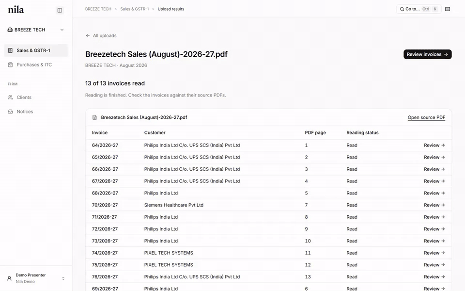
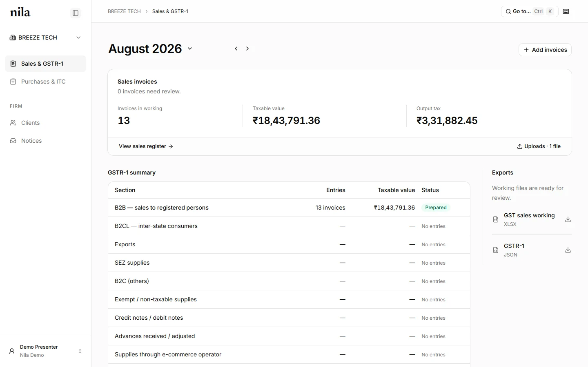
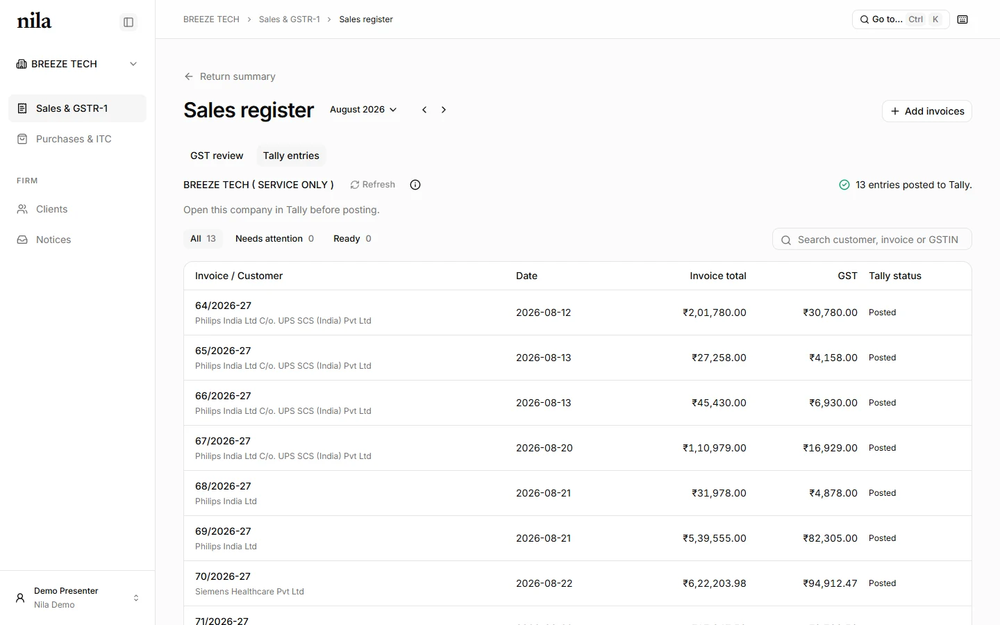
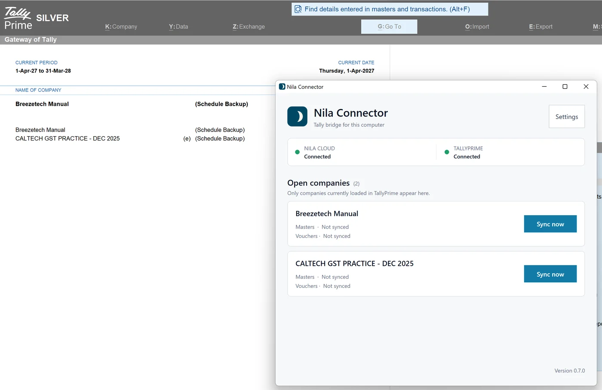
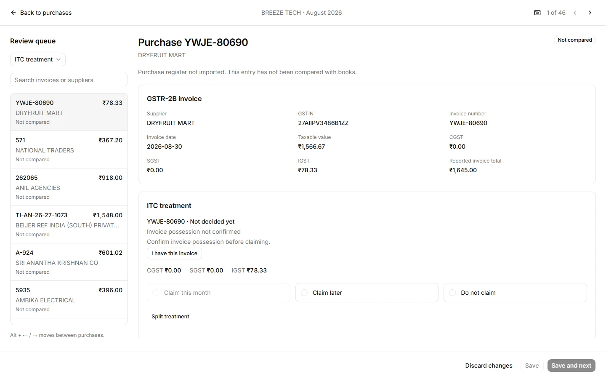

# Nila

Nila is an AI accountant for Indian CA firms, starting with GST. A firm uploads a
client's bills for the month, Nila reads every invoice, puts each one beside the
original page for checking, and prepares the Excel workings and GSTR-1 file the
firm would otherwise type up by hand.

I built it on my own from June to October 2026, with a lot of help from coding
agents. It ran in production at [nila.tax](https://nila.tax/) and worked on real
bills, and I paused it on October 8 before any firm adopted it.
[Why I stopped](https://vasanthk.pages.dev/writing/why-i-stopped-nila/) ·
[Case study](https://vasanthk.pages.dev/work/nila/) ·
[How the extraction works](https://vasanthk.pages.dev/writing/invoice-extraction/)



*A real month of bills from my parents' business: one 13-page PDF read into 13
invoices, each checked against its page, then rolled up into GSTR-1 workings.*

## What's in it

- **574 commits**, from June 21 to October 17, 2026. Before that, it started on
  May 26 as an app for service businesses in a separate repository.
- **About 66,000 lines of Elixir** and **39,000 lines of TypeScript**
- **1,779 Elixir tests** in about 47,000 lines
- **81 database migrations** on PostgreSQL
- **A Windows connector for Tally** in C#, in its own repository:
  [nila-connector](https://github.com/benzene73/nila-connector)

## The product

**Sales and GSTR-1.** Nila splits a PDF into invoices before reading them, so a
continuation page doesn't become a bill of its own. Each invoice is read into
structured fields with the page it came from, and the accountant reviews it
beside the original. Amounts printed on the bill stay separate from amounts Nila
calculates, so a mismatch shows up instead of being quietly fixed.


The month's invoices roll up into the GSTR-1 sections, with an Excel working the
senior can check and keep, and a JSON file for the GST portal.



**Tally.** Many firms keep everything in Tally, so reviewed invoices can be
posted there as vouchers through a small Windows connector that talks to the
TallyPrime running on the firm's computer.





**Purchases and ITC.** Nila fetches GSTR-2B, compares it with the purchase
register, and lets the accountant decide the input tax credit for each invoice:
claim this month, claim later, or don't claim.



There's also GST notice checking across all clients, bills arriving by WhatsApp
and email with reminders to clients who haven't sent theirs, bank statement
import into Tally, and a simple invoicing app for small businesses that shares
their sales with their CA.

## How it's built

- Phoenix 1.8 and PostgreSQL. Oban runs extraction and other background jobs.
- React, TypeScript, shadcn and Vite on the front end, served by Phoenix.
- The AI models only return structured readings of the bills. Calculations,
  validation, corrections and the return itself live in Elixir code that's tested.
- Extraction changes were measured against an evaluation corpus of real bills;
  see [`eval/`](eval/README.md).
- Production runs on AWS in Hyderabad, deployed from GitHub Actions through
  Systems Manager, with documents in a private Cloudflare R2 bucket.

More detail is in [`docs/`](docs/README.md): the [architecture](docs/architecture.md),
the [decisions](docs/decisions.md) behind it, and the
[product objective and customer evidence](docs/prd.md#current-objective).

## Run it locally

```bash
# dev.exs requires local PostgreSQL on localhost:5432.
mix setup
mix phx.server
```

Open http://localhost:4000 and use the development quick login.

```bash
mix test
mix ecto.reset
mix precommit
```

Production storage and WhatsApp setup are in [docs/operations.md](docs/operations.md).

## Layout

- `lib/nila/` — business contexts. `gst/` is the core: extraction, review, checks,
  sign-offs and returns. Plus accounts, orgs, clients, documents, notices, banking,
  Tally sync and storage.
- `lib/nila_web/` — controllers, APIs and web plumbing.
- `frontend/` — the React app.
- `eval/` — extraction evaluations.
- `docs/` — architecture, decisions, design and product notes.
